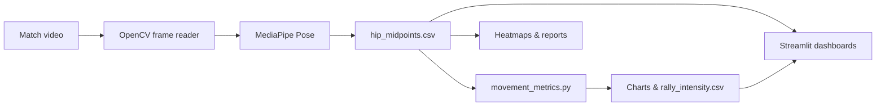

# Badminton Movement Analyzer

Hey, this is my badminton analytics project for GitHub. I built this badminton tool because I wanted to express the sport that I love into numbers and wanted to help players gain a better understanding of their movements. ” Watching raw match video doesn’t really answer that, so I tried to turn footage into **data** — where the player moves, how much they move, and when things get intense.

The pipeline is: **match video → AI pose tracking → CSV → math → charts + dashboards**. It sounds fancy, but it’s mostly Python scripts chained together, plus a Streamlit app (`match_dashboard.py`) so you don’t have to live in the terminal forever.

**Stack:** Python, **OpenCV** (video), **Google MediaPipe Pose** (body landmarks), **pandas** + **NumPy** (metrics), **matplotlib** (plots), **Streamlit** (web UI). I coded it in **Cursor** (with AI help when I got stuck) and put everything on **GitHub** so I could share it and not lose my work.

---

## How I built this (steps, in order)

This is basically the order I actually worked in — not the “clean textbook” order, but the real one.


| Step | What I did                                                                                  | Main file(s)              |
| ---- | ------------------------------------------------------------------------------------------- | ------------------------- |
| 1    | Made the repo layout: `videos/`, `output/`, `src/`, `requirements.txt`                      | project root              |
| 2    | Got MediaPipe running on my practice clip — skeleton overlay on video                       | `pose_detection.py`       |
| 3    | Saved **hip midpoint** every frame to CSV (the data everything else uses)                   | `extract_hip_midpoint.py` |
| 4    | First visualization: 2D heatmap of where the player spends time on screen                   | `heatmap.py`              |
| 5    | Added **movement distance**, center recovery, image zones, rally intensity                  | `movement_metrics.py`     |
| 6    | Drew a **badminton court** on top of the heatmap (BWF proportions)                          | `court_heatmap.py`        |
| 7    | Built a **side-by-side OpenCV viewer** — video + heatmap building live                      | `sync_viewer.py`          |
| 8    | One-shot **text report + summary image** for coaches / printing                             | `player_report.py`        |
| 9    | Built the **Match Timeline Dashboard** — slider, synced frame + cumulative heatmap, charts  | `match_dashboard.py`      |
| 10   | Debugged CSV column names, upside-down court Y-axis, zone naming, slow 5K video, frame sync | (see below)               |


So yeah — it started as “can I track pose?” and ended as a small analytics toolkit with dashboards. The CSV in the middle was the best decision because I only run MediaPipe once per video.

---

## What this project does (big picture)

1. **Read a badminton match video** (`.mp4`, `.mov`, `.avi`).
2. **Run MediaPipe Pose** on every frame and find the player’s body landmarks.
3. **Track the hip midpoint** (average of left hip + right hip) as a stand-in for “where the player is on screen.”
4. **Save every frame to a CSV** so all the analytics scripts can reuse the same data.
5. **Compute movement stats** — total distance, speed-ish per-frame movement, how far they drift from their average position, which parts of the *image* they hang out in, and “rally intensity” over 3-second windows.
6. **Visualize everything** — heatmaps, court overlays, timeline charts, text reports, and interactive Streamlit apps.

So the pipeline is basically: **video → pose → CSV → metrics → dashboard**.




---

## Project layout

```
badminton-analytics/
└── badminton-analyzer/
    ├── videos/          # put practice.mp4 here
    ├── output/          # CSVs, PNGs, reports, charts
    ├── src/
    │   ├── pose_detection.py       # live pose overlay on video (OpenCV window)
    │   ├── extract_hip_midpoint.py # MediaPipe → CSV (core data)
    │   ├── heatmap.py              # simple 2D movement heatmap
    │   ├── court_heatmap.py        # heatmap + drawn badminton court lines
    │   ├── sync_viewer.py          # side-by-side video + live accumulating heatmap
    │   ├── movement_metrics.py     # all the analytics + chart exports
    │   ├── player_report.py        # one-shot text report + summary image
    │   └── match_dashboard.py      # Streamlit match timeline dashboard
    └── requirements.txt
```

---

## Tools & platforms I used


| Thing                        | What I use it for                                                                      |
| ---------------------------- | -------------------------------------------------------------------------------------- |
| **Python 3**                 | All the logic                                                                          |
| **OpenCV (`opencv-python`)** | Open video files, read frames, show windows, resize for display, JET colormap heatmaps |
| **MediaPipe Pose**           | Detect 33 body landmarks per frame                                                     |
| **pandas**                   | Load CSV, rolling averages, zone counts                                                |
| **NumPy**                    | Distance formulas, histograms, density grids                                           |
| **matplotlib**               | Line charts, bar charts, `hist2d` heatmaps, court line drawing                         |
| **Streamlit**                | Interactive dashboards in the browser                                                  |
| **Cursor**                   | Coding + AI help while building                                                        |
| **GitHub**                   | Version control and sharing the repo                                                   |


Install dependencies:

```bash
cd badminton-analyzer
python -m venv venv
source venv/bin/activate   # Windows: venv\Scripts\activate
pip install -r requirements.txt
```

---

## How MediaPipe works in this project

MediaPipe Pose is a pretrained model that looks at each video frame and estimates where body parts are. It returns **landmarks** — points like shoulders, hips, knees, etc. Each landmark has:

- **x, y, z** in **normalized** space (roughly 0–1 across the width/height of the frame)
- **visibility** — how confident the model is that it actually sees that point

In `extract_hip_midpoint.py`, I don’t use the whole skeleton for movement stats. I use the **midpoint between `LEFT_HIP` and `RIGHT_HIP`** because it’s a stable “center of mass” style point that still moves when the player runs, lunges, or jumps.

For every frame:

1. OpenCV reads a BGR frame from the video.
2. Convert to RGB (MediaPipe expects RGB).
3. Call `pose.process(rgb)`.
4. If landmarks exist, average the two hips → save **normalized** coords and **pixel** coords (`x_px`, `y_px`).
5. Write one row per frame to CSV, including `detected=True/False` when pose isn’t found.

That CSV (`hip_midpoints.csv` in `output/`) is the **single source of truth** for every other script. No re-running MediaPipe unless you start a new analysis.

---

## The code, file by file

### `pose_detection.py`

This was my first “it works!” moment. It plays `videos/practice.mp4` in an OpenCV window and draws the full pose skeleton on top using MediaPipe’s drawing utils. Press `**q`** to quit. It’s great for checking that the camera angle and lighting are good enough for tracking before you run a long CSV export.

### `extract_hip_midpoint.py`

The workhorse. Functions:

- `hip_midpoint()` — math for averaging left/right hip.
- `extract_hip_midpoints(video_path, output_csv)` — loops all frames and writes CSV columns: `frame`, `timestamp_sec`, `detected`, `x_norm`, `y_norm`, `z_norm`, `x_px`, `y_px`, `visibility`.

Run standalone:

```bash
cd badminton-analyzer/src
python extract_hip_midpoint.py
```

Default paths: `../videos/practice.mp4` → `../output/hip_midpoints.csv`.

### `heatmap.py`

Reads the CSV, keeps rows where `detected == True`, and uses matplotlib `hist2d` on `x_px` / `y_px` to show **where on the video frame** the player spent the most time. Saves `output/heatmap.png`.

### `court_heatmap.py`

Same heatmap idea, but I overlay a **drawn badminton court** (outer boundary, singles sidelines, short service lines, center line, net labeled “NET”) using real **BWF court proportions** mapped onto a 0–1 plot. The player positions use normalized x and a **flipped y** (`y = 1 - y_norm`) so the net sits in the **middle** of the court visually — same orientation as how you’d expect to look at a court, not upside down.

### `sync_viewer.py`

Side-by-side OpenCV viewer:

- **Left:** current video frame.
- **Right:** cumulative heatmap built from every hip position **up to the current frame** (red dots + JET density).

Frames stay in sync by frame index; if a CSV row is missing, it picks the closest frame. Press `**q`** to exit. This lives purely in **image pixel space** (no court geometry) — it’s meant to “feel” like watching movement build up over time.

### `movement_metrics.py`

This is where most of the analytics live. Shared helpers like `load_tracking_positions()` drop rows without valid `x_px`/`y_px`.

**Movement metrics**

- Euclidean distance between consecutive frames: \sqrt{(x_2-x_1)^2 + (y_2-y_1)^2}
- Total distance, average per frame, max single-frame jump, frame count
- Chart: `movement_over_time.png` with a 30-frame rolling average and highlighted top 5 movement peaks

**Center recovery**

- Average position (\bar x, \bar y) across the match
- Per-frame distance from that center → average, max, standard deviation
- Chart: `center_distance_over_time.png`

**Image-based zone occupancy**

The frame is split into:

- **Top / Middle / Bottom** (vertical thirds of the *image*)
- **Left / Right** (half width)

Percent of frames in each zone → printed + `zone_occupancy.png` bar charts.

Important: these are **image-based zones**, not calibrated real-world court zones. I label them explicitly (“Top of frame”, etc.) and include a note in outputs so nobody confuses screen space with meters on a court.

**Rally intensity**

- Assumes ~30 FPS → **90 frames = 3 seconds**
- For each window: sum of movement = intensity score
- Saves `rally_intensity.csv` + `rally_intensity.png`

Run everything at once:

```bash
python movement_metrics.py
```

### `player_report.py`

Pulls movement, center recovery, and zones into one `**player_report.txt**` and builds `**player_summary.png**` (zone bar chart + smoothed movement line). Good when you just want a printable summary without opening Streamlit.

---

## Dashboard (Streamlit)

### `match_dashboard.py` — Match Timeline Dashboard

*(This is the main “match dash” app — the file is named `match_dashboard.py`, not `match_dash.py`.)*

**Purpose:** Explore a match you’ve **already processed** (`output/hip_midpoints.csv` + optional `rally_intensity.csv` + video in `videos/`).

**How it works:**

1. **Summary row** at the top — total distance, avg movement per frame, avg distance from center, frames analyzed.
2. **Section 1 — Synced video + heatmap**
  - Slider picks the frame index (0 … total_frames−1).
  - **Left column:** that exact frame from the video (OpenCV seeks with `CAP_PROP_POS_FRAMES`, converts BGR→RGB, scales down if huge).
  - **Right column:** cumulative heatmap of all hip positions from frame 0 through the selected frame (OpenCV `COLORMAP_JET` on a density grid).
  - **Metrics under that:** timestamp, movement this frame, rally intensity for the current 3s window, distance from center, hip `(x, y)`.
3. **Section 2 — Movement intensity** — line chart from `rally_intensity.csv` (or computed on the fly from hip CSV).
4. **Section 3 — Center recovery** — smoothed distance-from-center over time + average/max stats.
5. **Section 4 — Zone usage** — percentages + bar charts for vertical and horizontal image zones (with the coordinate-space note).

Streamlit `@st.cache_data` / `@st.cache_resource` keeps video metadata and CSV loads from re-running on every slider tick. When you move the slider, it only reads **one** frame — not the whole video every time — so scrubbing stays usable.

Run:

```bash
cd badminton-analyzer/src
streamlit run match_dashboard.py
```

---

## Typical workflow (what I actually do)

**Option A — Local video already in `videos/`**

1. `python extract_hip_midpoint.py` (or `pose_detection.py` first to sanity-check tracking)
2. `python movement_metrics.py`
3. `python player_report.py` if I want the text report
4. `streamlit run match_dashboard.py` to scrub through the match

**Option B — Cool demo mode**

1. After CSV exists: `python sync_viewer.py` for the live side-by-side heatmap build-up

---

## Problems I hit (and how I fixed them)

### CSV columns didn’t match my first heatmap script

I originally wrote the heatmap expecting columns named `hip_x` and `hip_y`, but the extractor saves `x_px`, `y_px`, and `detected`. The fix was straightforward: filter `detected == True` and use the real column names. Lesson: **one CSV schema** and every downstream script follows it.

### Court heatmap was upside down (net at the top)

MediaPipe’s normalized **y** grows downward (0 = top of image). Matplotlib’s default y axis grows upward. My court lines were drawn with the net at y=0.5 in “court space,” but the heatmap data wasn’t flipped the same way, so everything looked wrong.

Fix: use `**y = 1 - y_norm`** for plotting player positions and **stop** double-flipping with `invert_yaxis()`. Once heatmap and court lines share the same coordinate system, the net sits in the middle and movement reads correctly.

### “Front / back” sounded like real court positions

Splitting the frame into thirds is useful, but calling them “front” and “back” implied real badminton court geometry. I renamed them to **Top / Middle / Bottom of frame**, added the note about image coordinate space everywhere (reports, plots, dashboard captions), and kept `**court_heatmap.py`** separate for the *visual* court drawing.

### Massive video resolution = slow processing

My practice footage was thousands of frames at very high resolution (like 5K). MediaPipe still runs, but it takes a long time. I learned to:

- Run extraction once, save CSV, and never re-process unless I have to
- Use dashboards that **seek single frames** instead of replaying full video inside Streamlit
- Use `sync_viewer` / downscaled display widths where it’s only for viewing

### Frame sync between video and CSV

Video frame index and CSV `frame` column aren’t always perfect (dropped detections, etc.). Both `sync_viewer.py` and the dashboards use **closest matching row** for a given frame index so the UI stays aligned during scrubbing.

---

## Outputs you get


| File                            | Description                     |
| ------------------------------- | ------------------------------- |
| `hip_midpoints.csv`             | Per-frame hip midpoint tracking |
| `movement_over_time.png`        | Movement vs frame + highlights  |
| `center_distance_over_time.png` | Drift from average position     |
| `zone_occupancy.png`            | Time in image-based zones       |
| `rally_intensity.csv` / `.png`  | 3-second window intensity       |
| `heatmap.png`                   | Pixel-space density             |
| `court_heatmap.png`             | Density on drawn court          |
| `player_report.txt`             | Plain-text match summary        |
| `player_summary.png`            | Small multi-chart summary       |


---

## What I learned

- **Pose tracking is only step one.** The interesting part is turning landmarks into metrics coaches care about (movement load, recovery toward center, where they camp on screen).
- **Coordinate systems matter.** MediaPipe, OpenCV, and matplotlib all treat y differently if you’re not careful.
- **Separate “data generation” from “UI.”** CSV in the middle made it easy to add CLI tools, OpenCV viewers, and Streamlit later without rewriting MediaPipe code.
- **Be honest in the UI.** Image zones ≠ real court meters unless you calibrate the camera — labeling that saved me from over-interpreting charts.

---

## Quick reference commands

```bash
# Pose preview
python pose_detection.py

# Export tracking CSV
python extract_hip_midpoint.py

# All metrics + charts
python movement_metrics.py

# Text + summary image
python player_report.py

# Static heatmaps
python heatmap.py
python court_heatmap.py

# OpenCV sync viewer
python sync_viewer.py

# Streamlit match dashboard
streamlit run match_dashboard.py
```

---

## Limitations (being honest)

- Tracking is **one player** in frame — MediaPipe follows a body; crowded doubles footage gets messy.
- Distances are in **pixels**, not meters, unless you calibrate the camera to the court (I didn’t do full calibration yet).
- **Image zones** (top/middle/bottom of frame) are not the same as “front court / back court” in real BWF geometry — I label that everywhere so the charts aren’t misleading.
- Long **high-res videos** take a while to process; the CSV step is the slow part.

---

## Author

I’m a high school student who wanted real analytics from badminton video, not just vibes. This repo is the full journey: first pose overlay → CSV export → heatmaps → metrics → `**match_dashboard.py`**. If you’re reading this on GitHub, thanks for checking it out — clone it, drop a video in `videos/`, run hip extraction once, then open the match dashboard.

**Setup reminder:** run `pip install -r requirements.txt`, put `practice.mp4` (or your file) in `badminton-analyzer/videos/`, run `python extract_hip_midpoint.py`, then `streamlit run match_dashboard.py`.

---

## What I’m working on next

I’m building a **Coach Tool** so a coach can upload match video in the browser instead of copying files into `videos/` and running scripts by hand. The idea is upload → run analysis → see metrics and heatmaps in one place. Right now the upload button / flow isn’t working reliably on my side, so that piece isn’t part of the main README workflow yet — `**match_dashboard.py` + the CLI scripts are what work today**. I’ll update this section when the coach upload tool is solid.
